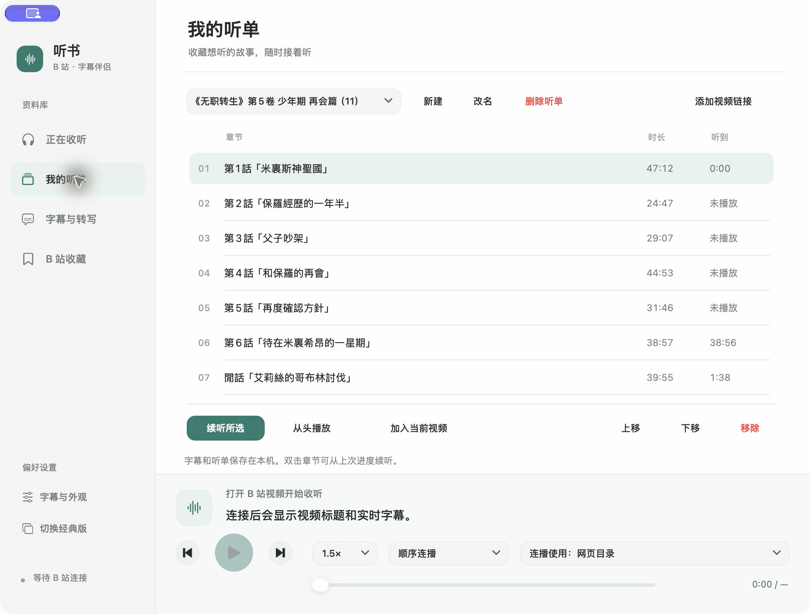
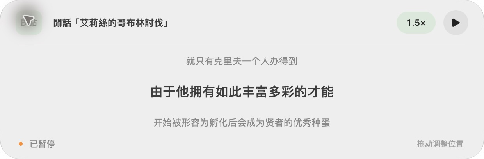
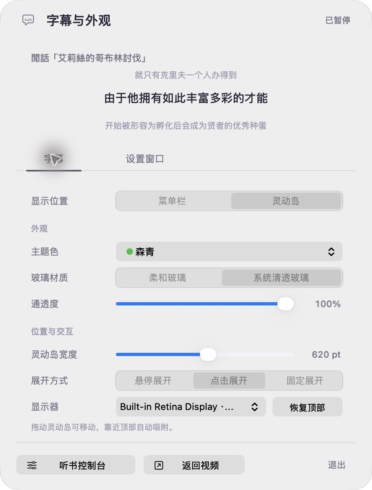
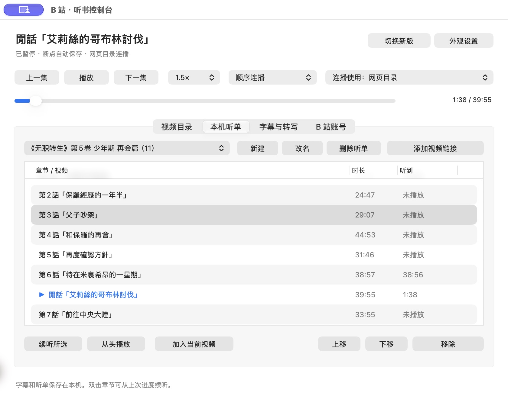
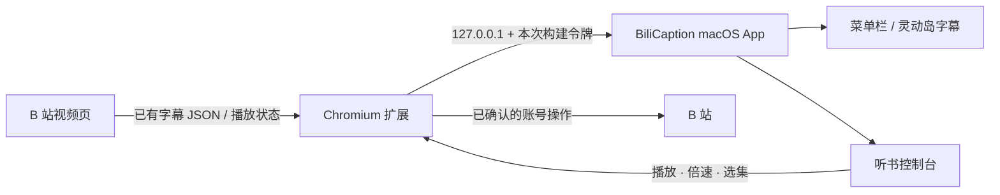

<div align="center">
  
  <h1>BiliCaption</h1>
  <p>把 B 站 AI 字幕放到 macOS 菜单栏，关掉浏览器也能接着「听书」。</p>
  <p>
    
    
    
    <a href="LICENSE"></a>
  </p>
  <p>
    <a href="#快速开始">快速开始</a> ·
    <a href="#功能">功能</a> ·
    <a href="#截图">截图</a> ·
    <a href="#工作原理">工作原理</a> ·
    <a href="#开发">开发</a>
  </p>
</div>

BiliCaption 是一个面向 macOS 的 B 站字幕伴侣。它通过一个轻量 Chromium 扩展读取视频页里**已经存在的 B 站字幕时间轴**，并把字幕同步到菜单栏或灵动岛。你可以在写作、读文档、做别的事情时继续看小说，同时直接控制 B 站的播放、倍速、进度和下一集。

> 这里的「AI 字幕」指 B 站为视频提供的 AI 字幕轨道。项目不会把音频上传到云端，也不会伪造视频原本没有的 B 站字幕。

## 功能

| 字幕显示 | 听书控制 | B 站联动 |
| --- | --- | --- |
| 菜单栏单行字幕 | 播放、暂停、上一集、下一集 | 同步分 P / UGC 合集目录 |
| 可拖动的灵动岛 | 0.5×–3× 倍速 | 读取、切换 B 站字幕轨道 |
| 上下文前后句 | 拖动进度、断点续听 | 收藏夹与稍后再看 |
| 主题色、宽度、透明度 | 顺序、单集循环、播完停止 | 自动开启与重新同步字幕 |
| 柔和 / 清透玻璃 | 网页目录或本机听单连播 | 可选设备端语音转写 |

现代版控制台提供左侧导航、章节表、统一播放器以及独立的字幕与外观设置。经典版完整保留，可随时切换。

### 为「听书」优化

- **不用盯着浏览器**：字幕直接从 B 站时间轴跟随视频播放，不用截屏识别文字。
- **多标签页不打架**：以浏览器标签和视频 CID 区分字幕来源，隐藏标签页的旧 DOM 字幕不会污染新时间轴。
- **断点与听单**：章节、进度和播放速度保存在本机，双击章节即可续听。
- **本机优先**：字幕、听单和进度只在本机处理；不需要把 B 站密码交给这个应用。
- **无字幕也能转写**：可以明确启动 Apple 设备端中文语音识别，首次使用需授予屏幕与系统音频录制、语音识别权限。

## 截图


| 灵动岛 | 字幕与外观 |
| --- | --- |
|  |  |
| 当前字幕突出显示，支持倍速、暂停和拖动定位。 | 主题色、玻璃材质、透明度与展开方式分别保存。 |

| 经典版控制台 |
| --- |
|  |
| 保留原来的紧凑布局；现代版与经典版共用听单、进度和播放状态。 |

## 快速开始

### 环境要求

- macOS 13 或更新版本
- Xcode Command Line Tools（`xcode-select --install`）
- Node.js 18+（只用于构建浏览器扩展和运行测试）
- Chrome 111+、Arc 或其他兼容 Manifest V3 的 Chromium 浏览器

### 1. 构建

```bash
git clone https://github.com/fyh2001/BiliCaption.git
cd BiliCaption
chmod +x scripts/build.sh scripts/test.sh
./scripts/build.sh
```

构建脚本会在本机生成一个只属于当前构建的随机桥接密钥，并输出：

```text
.build/BiliCaption.app
.build/extension
```

桥接密钥位于 `.build/bridge-token`，已经在 `.gitignore` 中排除。应用和扩展必须来自同一次构建。

### 2. 安装应用

打开 `.build/BiliCaption.app`。应用没有 Dock 窗口，会常驻菜单栏。第一次 macOS 可能提示本地构建应用安全性，请在“系统设置 → 隐私与安全性”中允许本次构建，或使用 Xcode Command Line Tools 重新构建。

### 3. 加载扩展

1. 在 Chrome 或 Arc 打开 `chrome://extensions`。
2. 开启“开发者模式”。
3. 选择“加载已解压的扩展程序”。
4. 选择仓库中的 **`.build/extension`** 文件夹。
5. 打开或刷新 B 站视频页，保持视频标签页运行。

如果替换了应用或重新构建，请同时重新加载 `.build/extension`，确保两边使用相同的桥接密钥。

### 4. 开始收听

打开 B 站视频后，菜单栏图标会显示实时字幕。点击图标可调整字幕与外观，也可以进入“听书控制台”管理章节、听单、倍速和字幕来源。

切换标签页、打开其他应用，甚至遮住浏览器都可以继续显示字幕。浏览器休眠、网页计时器被暂停或标签页被冻结时，字幕会暂停推演并在连接恢复后重新同步。

## 工作原理



扩展在视频页的早期加载阶段观察播放器已有的字幕请求，只接受 B 站字幕域名和当前分 P 的 CID。原生应用在 `127.0.0.1:17373` 接收数据，并返回严格校验过的播放控制命令。

字幕正文只保存在内存中。听单和播放进度保存在 `~/Library/Application Support/BiliCaption/listening-library.json`。

## 隐私与边界

- 不读取或转发 B 站密码、Cookie、CSRF 到原生应用。
- 收藏夹写入只会使用浏览器的现有登录态，并且在应用内确认后执行。
- 本机语音转写默认关闭；开始后只捕获所选浏览器的系统音频，不上传云端、不保存录音。
- B 站没有字幕时，BiliCaption 无法凭空生成一条“B 站 AI 字幕”；可选择本机语音转写。
- 项目依赖 B 站当前网页结构。网站接口或播放器更新后，扩展片段可能需要更新。
- 项目与哔哩哔哩官方没有关联。使用者应自行遵守网站条款和当地法律，并尊重视频作者与版权。

## 开发

运行全部自动化测试：

```bash
./scripts/test.sh
```

测试覆盖字幕时间轴、播放倍速、断点、来源隔离、字幕 URL 白名单、命令去重、收藏夹分页与账号操作的信任边界。原生代码以 macOS 13 deployment target 编译，扩展使用 Manifest V3。

```text
.
├── native/                 # Swift / AppKit 菜单栏应用
├── extension/              # Manifest V3 浏览器扩展源码与测试
├── tests/native/           # 字幕与播放核心测试
├── scripts/                # 构建与测试脚本
├── docs/images/            # README 展示图片
└── .github/workflows/      # macOS CI
```

修改扩展源码后不要直接提交生成的 bundle；`scripts/build.sh` 会在 `.build/extension` 中生成完整运行目录。

## 常见问题

**菜单栏显示“等待连接”？**  
确认 B 站视频标签页仍然打开，扩展已启用，并且应用与扩展来自同一次 `scripts/build.sh` 构建。

**配对密钥不匹配？**  
删除或保留 `.build/bridge-token` 后重新运行 `scripts/build.sh`，然后重新加载 `.build/extension`。两边需要来自同一输出目录。

**为什么没有自动出现 AI 字幕？**  
先确认该视频在 B 站网页中确实提供字幕轨道。进入“字幕与转写”检查轨道列表，或切换“优先 AI 中文 / 人工中文”。

**为什么本机转写没有启动？**  
首次使用需要在 macOS 中授予语音识别和系统音频录制权限。只使用设备端中文语音模型，模型不可用时会显示具体原因。

## License

[MIT](LICENSE) © 2026 Fang Yao Hua
